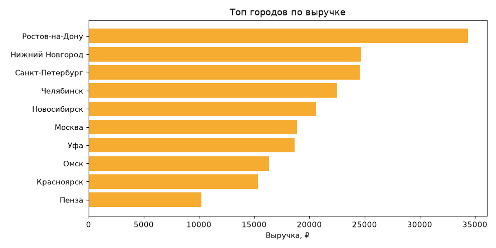
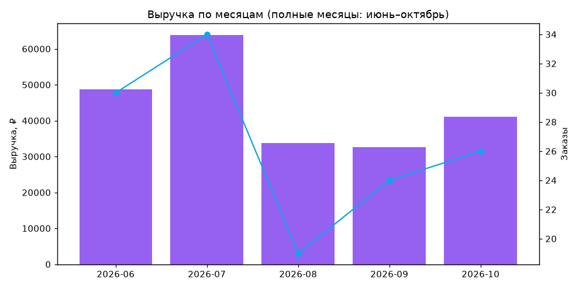
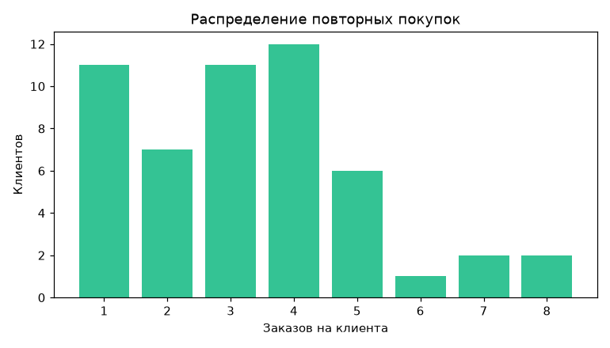

# 📚 bookshop_py


**Мой проект — интернет-магазин книг на FastAPI + MySQL, на котором я провела продуктовую аналитику.**

> Это учебный e-commerce-проект, где главное — **продуктовый анализ данных**. Я построила бэкенд и наполнила базу реалистичными данными за полгода (заказы, покупатели, города, отзывы, повторные покупки), а затем провела на них аналитический разбор: посчитала метрики, построила гео-срезы, выявила проблемы и сформулировала гипотезы для A/B-тестов. Ниже — методика и главные выводы.

## Что это и как устроено

```
Браузер (HTML+JS)  →  FastAPI (Python)  →  MySQL (bookshop_full)
   frontend/            app/main.py           уже существующая схема
```

Бэкенд (FastAPI + SQLAlchemy Core) отдаёт REST API и SPA-фронтенд, а поверх БД `bookshop_full` построен **аналитический слой**: админ-дашборд с KPI и CSV/графики через `analysis/` (pandas + matplotlib). Данные — за ~6 месяцев, как в реальном проекте.

## Продуктовая аналитика — ядро проекта

**Методика.** Данные выгружаются из БД в CSV (`report.py`), затем считаются метрики и строятся графики (`analyze.py` + `analyze.ipynb`). Считаю **e-commerce-метрики** (не B2B-SaaS): GMV, средний чек (среднее/медиана/σ), ARPPU/LTV, повторные покупки, гео, отмены и статусы.

**Фактические цифры за ~6 месяцев:**

| Метрика                                                      | Значение                                          |
| ------------------------------------------------------------------- | --------------------------------------------------------- |
| **GMV** (заказы кроме отменённых)        | **269 180 ₽**                                      |
| Заказов (не отменённых) / Покупателей | 172 / 52                                                  |
| **AOV** (средний чек)                               | **1 565 ₽** (медиана 1 280 ₽, σ 1 053 ₽) |
| **ARPPU / LTV** (на покупателя)                   | **5 177 ₽** (медиана 4 890 ₽)              |
| Среднее заказов на покупателя             | 3.31 (медиана 3)                                   |
| Повторных покупателей (≥2 заказа)        | **78.8%** (41 из 52)                              |
| Отменённых заказов                                 | 13 (7%)                                                   |

**Главные выводы (что показал анализ):**

1. **Выручка сконцентрирована** в нескольких городах (Ростов, Нижний, Челябинск, Новосибирск) малым числом покупателей — риск зависимости.
   
2. **Август — провал** (19 заказов, ~34 тыс. ₽) на фоне июльского пика (63,9 тыс. ₽).
   
3. **Повторные покупки (78.8%)** — большинство покупателей возвращается (распределение по числу заказов на клиента).
   
4. **Операционно:** 56 заказов «ждут обработки» (`new`/`processing`), 13 отменённых — нет автоматического продвижения статусов.

**Гипотезы для A/B-тестов** (сформулированы, не проведены — нужен живой трафик):
промокод после первой покупки (метрика — повтор в m1), акция к августу (GMV августа), точечные акции в топ-городах (AOV города), автоматизация статусов (доля `completed` за 3 дня), достройка воронки через логирование `view_cart`/`checkout` (cart-abandonment).

> **Важно про воронку.** Полную воронку `view → cart → order` по `event_log` построить нельзя: в журнале нет `view_cart`/`checkout`, а событий `add_to_cart` (89) меньше, чем `order_created` (185). Сейчас воронка оценивается по статусам заказов; полноценная cart-abandonment — после достройки логирования. Подробно — [`docs/analytics.md`](docs/analytics.md), [`analysis/analyze.ipynb`](analysis/analyze.ipynb).

## Прочее, что уже реализовано

| Что сделано                                                    | Суть                                                                                                                                                                                 |
| ------------------------------------------------------------------------ | ---------------------------------------------------------------------------------------------------------------------------------------------------------------------------------------- |
| **Единая авторизация с ролями user/dmin** | PBKDF2-пароли, подписанные HMAC-токены; аналитика и жалобы — только для dmin.                                                          |
| **Семантический (ИИ) поиск**                   | Без внешних моделей: нормализация фразы + синонимы тем + idf-ранжирование.                                                      |
| **Операционные фичи**                              | Избранное (идемпотентное), жалобы с эскалацией статусов (admin), заказ в транзакции с контролем остатка. |
| **Инженерная обвязка**                            | Docker + docker-compose, .env/секреты, Swagger, параметризованные SQL, документация.                                                                 |

## Стек

- **Backend:** FastAPI + SQLAlchemy Core (PyMySQL) + Pydantic.
- **Frontend:** SPA на чистом `HTML+CSS+JS` (fetch → JSON), тёмная glass-тема, анимации.
- **Аналитика:** pandas + matplotlib, CSV-выгрузка из БД.
- **БД:** MySQL `bookshop_full` (utf8mb4) — не пересоздаётся, дополняется миграциями.

---

## Быстрый старт

```bash
python -m venv .venv
.venv\Scripts\activate        # Windows  (macOS/Linux: source .venv/bin/activate)
pip install -r requirements.txt
copy .env.example .env        # указать DATABASE_URL и JWT_SECRET
uvicorn app.main:app --reload --port 8000
```

Откройте `http://localhost:8000`. Swagger UI: `http://localhost:8000/docs`.

---

## Эндпоинты (сводка)

| Метод | Путь                         | Auth            | Описание                                                                 |
| ---------- | -------------------------------- | --------------- | -------------------------------------------------------------------------------- |
| GET        | `/api/products`                | нет          | Список товаров (`?category=`, `?q=`, `?limit=`, `?offset=`) |
| GET        | `/api/products/{id}`           | нет          | Карточка товара                                                    |
| GET        | `/api/categories`              | нет          | Категории                                                               |
| POST       | `/api/orders`                  | опц.         | Создать заказ (в транзакции; `city?`)                   |
| POST       | `/api/ai/search`               | нет          | ИИ-поиск по смыслу (`query`, `limit`)                         |
| GET        | `/api/favorites`               | да            | Список избранного                                                |
| POST       | `/api/favorites`               | да            | Добавить в избранное (`product_id`)                          |
| DELETE     | `/api/favorites/{id}`          | да            | Убрать из избранного                                           |
| GET        | `/api/favorites/{id}`          | да            | Проверить, в избранном ли                                   |
| POST       | `/api/complaints`              | опц.         | Подать жалобу о проблеме с книгой                    |
| GET        | `/api/complaints`              | **admin** | Список жалоб                                                          |
| PATCH      | `/api/complaints/{id}`         | **admin** | Сменить статус жалобы                                         |
| POST       | `/api/auth/register`           | нет          | Регистрация                                                           |
| POST       | `/api/auth/login`              | нет          | Вход                                                                         |
| GET        | `/api/auth/me`                 | да            | Текущий пользователь                                          |
| GET        | `/api/analytics/order-facts`   | **admin** | Факты заказов                                                        |
| GET        | `/api/analytics/product-sales` | **admin** | Продажи по товарам                                               |
| GET        | `/api/analytics/daily-revenue` | **admin** | Выручка по дням                                                     |
| GET        | `/api/analytics/event-log`     | **admin** | Журнал событий                                                      |
| GET        | `/api/analytics/kpi`           | **admin** | Сводные KPI                                                               |
| GET        | `/api/analytics/cities`        | **admin** | Топ городов                                                            |
| GET        | `/api/analytics/reviews`       | **admin** | Отзывы                                                                     |
| GET        | `/api/health`                  | нет          | Проверка БД                                                            |

**Auth:** заголовок `Authorization: Bearer <token>`. Роль `admin` даёт доступ к аналитике и обработке жалоб. Все подробности — [`docs/api.md`](docs/api.md).

---

## Стек

| Аспект           | Python `bookshop_py`                                           |
| ---------------------- | ---------------------------------------------------------------- |
| Backend                | **Python 3.12+ (FastAPI)**                                 |
| БД                   | **та же MySQL `bookshop_full`**                      |
| API                    | **FastAPI-эндпоинты**                             |
| Frontend               | **HTML+JS (fetch → JSON)**                                |
| Авторизация | **единый вход по ролям (`users.role`)** |
| Аналитика     | **витрины + KPI + города + отзывы**     |

Подробно: [`docs/architecture.md`](docs/architecture.md), [`docs/auth-roles.md`](docs/auth-roles.md).

---

## Структура проекта

```
bookshop_py/
├── app/                       # FastAPI-приложение
│   ├── main.py                # маршруты, авторизация, отдача frontend
│   ├── db.py                  # подключение SQLAlchemy + helpers
│   ├── auth.py                # пароли (PBKDF2) + подписанные токены
│   ├── services.py            # бизнес-логика: товары, заказ, избранное, жалобы, аналитика
│   └── schemas.py             # Pydantic-схемы
├── frontend/                  # SPA (HTML + CSS + JS)
│   ├── index.html             # каталог, корзина, чекаут, аналитика
│   ├── style.css
│   └── app.js                 # вызовы API (fetch + Bearer)
├── db/                        # SQL-миграции
│   └── favorites.sql          # CREATE TABLE favorites
├── docs/                      # документация (см. раздел ниже)
├── requirements.txt           # pip-зависимости (нужен в корне — Dockerfile делает COPY)
├── Dockerfile                 # образ (в корне — контекст сборки)
├── docker-compose.yml         # app + MySQL (в корне — docker compose up)
├── .env.example               # шаблон переменных окружения
└── README.md                  # этот файл — единственная точка входа
```

---

## Документация

| Документ                                                      | Содержание                                                                                                                                            |
| --------------------------------------------------------------------- | --------------------------------------------------------------------------------------------------------------------------------------------------------------- |
| [docs/requirements/requirements.md](docs/requirements/requirements.md) | **Функциональные (FR)** и **нефункциональные (NFR)** требования, роли, критерии приёмки |
| [docs/requirements/user-stories.md](docs/requirements/user-stories.md) | User stories по ролям + матрица покрытия US→FR                                                                                           |
| [docs/requirements/use-cases.md](docs/requirements/use-cases.md)       | Варианты использования (UC) с потоками и API                                                                                     |
| [docs/requirements/bpmn.md](docs/requirements/bpmn.md)                 | **BPMN-диаграммы** ключевых процессов (Mermaid)                                                                                 |
| [docs/architecture.md](docs/architecture.md)                           | Архитектура: слои, компоненты, потоки данных                                                                               |
| [docs/api.md](docs/api.md)                                             | Все REST-эндпоинты, тела запросов, коды статусов                                                                            |
| [docs/database-schema.md](docs/database-schema.md)                     | ERD + полный словарь данных (таблицы, поля, связи)                                                                           |
| [docs/database.md](docs/database.md)                                   | Миграции проекта, демо-данные, владелец-админ                                                                             |
| [docs/auth-roles.md](docs/auth-roles.md)                               | Вход, роли user/dmin, как зайти в аналитику                                                                                          |
| [docs/analytics.md](docs/analytics.md)                                 | KPI, вкладки, гео, отзывы, выгрузка для DS                                                                                           |
| [docs/setup.md](docs/setup.md)                                         | Запуск, .env, Docker, деплой, безопасность                                                                                              |
| [docs/roadmap.md](docs/roadmap.md)                                     | Что сделано / в планах (фазы, приоритеты)                                                                                        |
