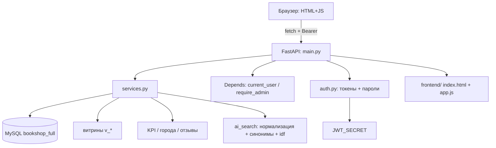

# Архитектура (Architecture) — bookshop_py

## 1. Обзор

`bookshop_py` — **монолитный FastAPI-бэкенд** со **SPA-фронтендом** (один `index.html` + `app.js` + `style.css`), который переиспользует **существующую** БД `bookshop_full` (не пересоздаёт её). Слои разделены: маршруты (`main.py`), бизнес-логика (`services.py`), валидация (`schemas.py`), доступ к БД (`db.py`), авторизация (`auth.py`), отдача статики/фронта.

```
Браузер (HTML+JS)  ←→  FastAPI (main.py)  ←→  services.py  ←→  db.py  ←→  MySQL (bookshop_full)
   frontend/                                                         SQLAlchemy Core
```

## 2. Слои (Layers)

```
┌──────────────────────────────────────────────────────────────┐
│                ПРЕДСТАВЛЕНИЕ / КЛИЕНТ (frontend/)            │
│  index.html · app.js · style.css                             │
│  (fetch → JSON, Bearer-токен, localStorage)                  │
├──────────────────────────────────────────────────────────────┤
│                        КОНТРОЛЛЕР (main.py)                  │
│  FastAPI-маршруты, депенденси (Blocking deps: current_user,  │
│  require_admin), отдача frontend/ и статики                  │
├──────────────────────────────────────────────────────────────┤
│                        БИЗНЕС-ЛОГИКА (services.py)           │
│  товары, категории, заказ (транзакция), избранное, жалобы,   │
│  ИИ-поиск, аналитика (KPI/города/отзывы/витрины)             │
├──────────────────────────────────────────────────────────────┤
│                        ДОСТУП К ДАННЫМ (db.py)               │
│  SQLAlchemy Core (engine, fetch_all/one, transaction,        │
│  run_in_transaction), сериализация Decimal/Date/DateTime     │
├──────────────────────────────────────────────────────────────┤
│                        АВТОРИЗАЦИЯ (auth.py)                 │
│  PBKDF2-HMAC-SHA256 (пароли), подписанные токены (HMAC-SHA)  │
├──────────────────────────────────────────────────────────────┤
│                        ДАННЫЕ (MySQL bookshop_full)          │
│  users, products, categories, orders, order_items,           │
│  order_status_history, favorites, reviews, complaints,        │
│  event_log, витрины v_*                                      │
└──────────────────────────────────────────────────────────────┘
```

## 3. Компоненты

| Модуль | Ответственность | Файлы |
|--------|-----------------|-------|
| `main.py` | FastAPI-приложение, маршруты, депенденси, отдача фронта | `app/main.py` |
| `services.py` | Бизнес-логика: товары, заказ, избранное, жалобы, ИИ-поиск, аналитика | `app/services.py` |
| `schemas.py` | Pydantic-схемы валидации входных/выходных данных | `app/schemas.py` |
| `db.py` | Доступ к БД (SQLAlchemy Core), транзакции, сериализация | `app/db.py` |
| `auth.py` | Хеширование паролей, подписанные токены | `app/auth.py` |
| `frontend/` | SPA: каталог, корзина, чекаут, избранное, аналитика, ИИ-чат | `frontend/*` |

## 4. Ключевые проектные решения

### 4.1 Единый токен вместо отдельного API-токена
Раньше аналитика защищалась `API_TOKEN` / `require_token`. Теперь — **вход пользователя** с подписанным токеном (`JWT_SECRET`). Роль (`users.role`) определяет доступ к `/api/analytics/*` и админ-жалобам через `require_admin`. Это единая схема авторизации и для покупателя, и для владельца.

### 4.2 Заказ в транзакции
`create_order` атомарно: определяет/создаёт `users`, создаёт `orders`, вставляет `order_items` (фиксирует **effective price**), списывает `products.in_stock`, пишет `order_status_history` (`new`) и событие `order_created`.

### 4.3 «Операционная» и «аналитическая» модели разделены
- **Операционная:** `products`, `orders`, `order_items`, `users` — меняются в реальном времени.
- **Аналитическая:** `event_log`, `order_status_history`, `reviews`, `complaints`, витрины `v_*`.

### 4.4 Аналитика поверх витрин + собственные агрегаты
`services.get_analytics` читает витрины `v_order_facts`, `v_product_sales`, `v_daily_revenue`, `v_event_log`. Дополнительно реализованы KPI (`get_analytics_kpi`), города (`get_analytics_cities`), отзывы (`get_analytics_reviews`).

### 4.5 Effective price
`products.base_price` — текущая витринная цена; `order_items.price` — зафиксированная на момент покупки.

### 4.6 Смарт-поиск без внешних моделей
`ai_search` — лёгкий матчинг: нормализация, стоп-слова, синонимы тем, idf-взвешивание, ранжирование по названию/автору/описанию/категории. Без эмбеддингов.

## 5. Поток данных: оформление заказа

1. `POST /api/orders` → `services.create_order(payload, user_id)`.
2. В транзакции: определяет `user_id` (авторизованный → обновить профиль; гость → найти/создать по email).
3. Подсчитывает сумму, проверяет товары (`effective price` в `order_items`).
4. Создаёт `orders` (`status='new'`), `order_items`, списывает `in_stock`.
5. Пишет `order_status_history` и событие `order_created`.
6. `commit` → возвращает `{ order_id, total_amount, status }`.

## 6. Поток данных: аналитика

1. Пользователь с ролью `admin` открывает «📊 Аналитика».
2. `app.js` → `refreshAnalyticsGate` в `currentUser.role` → вызывает `/api/analytics/*` с Bearer-токеном.
3. `main.py` через `require_admin` допускает только `admin`.
4. `services` читает витрины/агрегаты, возвращает JSON.
5. Фронт строит KPI-карточки и таблицы.

## 7. Развёртывание (Deployment)

- **Локально:** venv + `requirements.txt`, uvicorn `app.main:app`.
- **Docker:** `Dockerfile` (Python 3.12-slim) + `docker-compose.yml` (app + MySQL 5.7).
- **Облако:** переменные `DATABASE_URL` и `JWT_SECRET`.

## 8. Диаграмма компонентов (Mermaid)



## 9. Как расширять

- Вынести аналитику/витрины в OLAP (Postgres/ClickHouse).
- Добавить дашборд с графиками (Chart.js), экспорт в Parquet, пайплайн DuckDB/pandas.
- Добавить CRUD-управление товарами/категориями на фронте (сейчас — только аналитика и жалобы).
- Покрыть тестами (pytest) + CI.