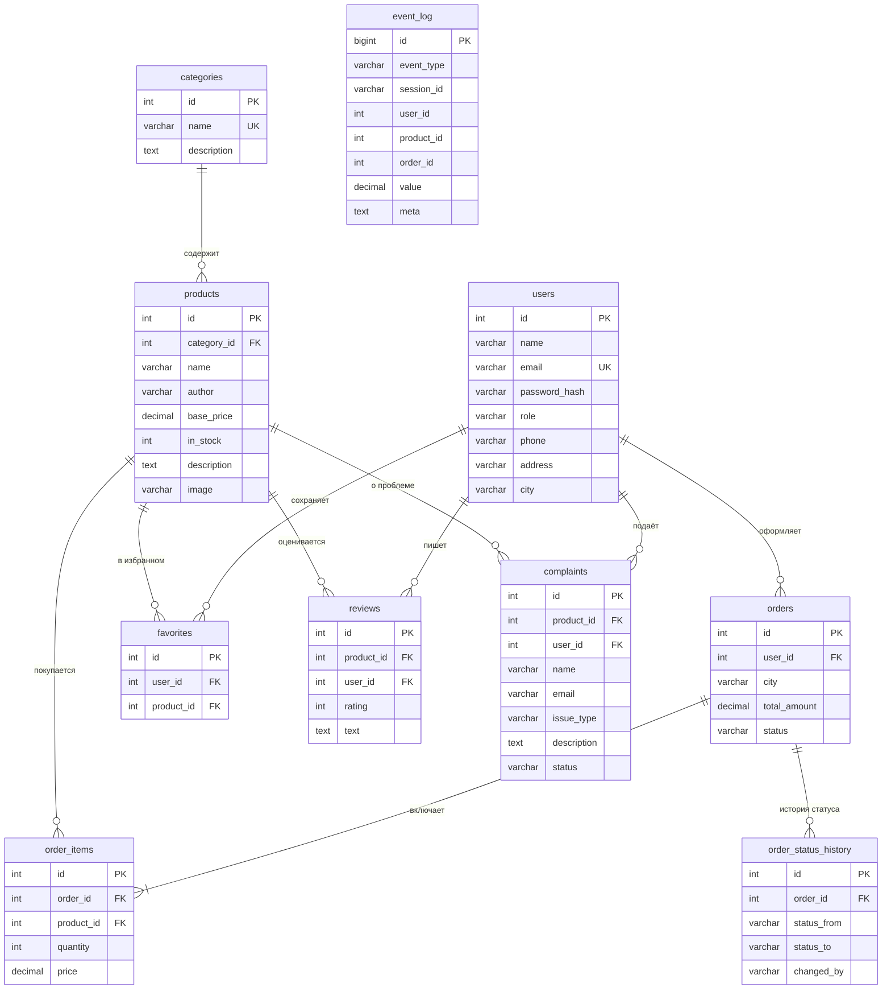

# Схема базы данных (Database Schema) — bookshop_py

База: **`bookshop_full`**, движок **InnoDB**, кодировка **utf8mb4 / utf8mb4_unicode_ci**.

> ⚠️ `bookshop_py` **не создаёт** БД заново — он работает поверх существующей `bookshop_full` (из PHP-версии) и **дополняет** её. Ниже — фактическая схема (сверена с `information_schema` живой БД), включая поля и таблицы, добавленные Python-проектом: `users.role`, `users.city`, `users.password_hash`, `orders.city`, таблицы `favorites`, `reviews`, `complaints`.

Связанные документы: [database](database.md) (миграции и демо-данные), [analytics](analytics.md), [architecture](architecture.md).

---

## 1. ERD (сущность–связь)

---

## 2. Словарь данных (Data Dictionary)

### 2.1 `categories`
| Поле | Тип | Ключ | Null | По умолчанию | Описание |
|------|-----|------|------|--------------|----------|
| `id` | INT | PK, AI | NO | — | Идентификатор категории |
| `name` | VARCHAR(191) | UNIQUE | NO | — | Название |
| `description` | TEXT | | YES | NULL | Описание |
| `created_at` | TIMESTAMP | | NO | CURRENT_TIMESTAMP | Создано |
| `updated_at` | DATETIME | | YES | NULL | Изменено |

### 2.2 `products`
| Поле | Тип | Ключ | Null | По умолчанию | Описание |
|------|-----|------|------|--------------|----------|
| `id` | INT | PK, AI | NO | — | Идентификатор товара |
| `category_id` | INT | FK → categories | YES | NULL | Категория (`ON DELETE SET NULL`) |
| `name` | VARCHAR(255) | MUL | NO | — | Название (индекс для поиска) |
| `author` | VARCHAR(255) | | YES | NULL | Автор |
| `base_price` | DECIMAL(10,2) | MUL | NO | 0.00 | Витринная (текущая) цена |
| `in_stock` | INT | | NO | 0 | Остаток на складе |
| `description` | TEXT | | YES | NULL | Описание |
| `image` | VARCHAR(255) | | YES | NULL | Имя файла в `uploads/` |
| `created_at` | TIMESTAMP | | NO | CURRENT_TIMESTAMP | Создано |
| `updated_at` | DATETIME | | YES | NULL | Изменено |

### 2.3 `users` — *расширена проектом*
| Поле | Тип | Ключ | Null | По умолчанию | Описание |
|------|-----|------|------|--------------|----------|
| `id` | INT | PK, AI | NO | — | Идентификатор |
| `name` | VARCHAR(255) | | NO | — | ФИО |
| `email` | VARCHAR(191) | UNIQUE | NO | — | Email (логин) |
| `password_hash` | VARCHAR(255) | | YES | NULL | **Добавлено:** PBKDF2-хеш пароля |
| `role` | VARCHAR(20) | | NO | `user` | **Добавлено:** `user` / `admin` |
| `phone` | VARCHAR(50) | | YES | NULL | Телефон |
| `address` | VARCHAR(255) | | YES | NULL | Адрес доставки |
| `city` | VARCHAR(191) | | YES | NULL | **Добавлено:** город |
| `created_at` | TIMESTAMP | | NO | CURRENT_TIMESTAMP | Создано |
| `updated_at` | DATETIME | | YES | NULL | Изменено |

### 2.4 `orders` — *расширена проектом*
| Поле | Тип | Ключ | Null | По умолчанию | Описание |
|------|-----|------|------|--------------|----------|
| `id` | INT | PK, AI | NO | — | Идентификатор заказа |
| `user_id` | INT | FK → users | NO | — | Покупатель |
| `city` | VARCHAR(191) | | YES | NULL | **Добавлено:** город доставки (для гео-аналитики) |
| `total_amount` | DECIMAL(10,2) | | NO | 0.00 | Итоговая сумма |
| `status` | VARCHAR(20) | MUL | NO | `new` | `new/processing/shipped/completed/cancelled` |
| `created_at` | TIMESTAMP | MUL | NO | CURRENT_TIMESTAMP | Создано |
| `updated_at` | DATETIME | | YES | NULL | Изменено |

### 2.5 `order_items`
| Поле | Тип | Ключ | Null | По умолчанию | Описание |
|------|-----|------|------|--------------|----------|
| `id` | INT | PK, AI | NO | — | Идентификатор строки |
| `order_id` | INT | FK → orders | NO | — | Заказ (`ON DELETE CASCADE`) |
| `product_id` | INT | FK → products | NO | — | Товар |
| `quantity` | INT | | NO | 1 | Количество |
| `price` | DECIMAL(10,2) | | NO | 0.00 | **Effective price** — цена на момент покупки |
| `created_at` | TIMESTAMP | | NO | CURRENT_TIMESTAMP | Дата |

### 2.6 `order_status_history`
| Поле | Тип | Ключ | Null | По умолчанию | Описание |
|------|-----|------|------|--------------|----------|
| `id` | INT | PK, AI | NO | — | Идентификатор |
| `order_id` | INT | FK → orders | NO | — | Заказ (`ON DELETE CASCADE`) |
| `status_from` | VARCHAR(20) | | YES | NULL | Прежний статус |
| `status_to` | VARCHAR(20) | | NO | — | Новый статус |
| `changed_by` | VARCHAR(100) | | YES | NULL | Кто изменил (`admin` / `customer`) |
| `changed_at` | TIMESTAMP | | NO | CURRENT_TIMESTAMP | Время изменения |

### 2.7 `favorites` — *добавлена проектом*
| Поле | Тип | Ключ | Null | По умолчанию | Описание |
|------|-----|------|------|--------------|----------|
| `id` | INT | PK, AI | NO | — | Идентификатор |
| `user_id` | INT | FK → users | NO | — | Пользователь (`ON DELETE CASCADE`) |
| `product_id` | INT | FK → products | NO | — | Книга (`ON DELETE CASCADE`) |
| `created_at` | TIMESTAMP | | NO | CURRENT_TIMESTAMP | Когда добавлено |

**Уникальность:** `uq_favorites_user_product (user_id, product_id)` — дубликаты запрещены (идемпотентное добавление). DDL: `db/favorites.sql`.

### 2.8 `reviews` — *добавлена проектом*
| Поле | Тип | Ключ | Null | По умолчанию | Описание |
|------|-----|------|------|--------------|----------|
| `id` | INT | PK, AI | NO | — | Идентификатор |
| `product_id` | INT | FK → products | NO | — | Книга |
| `user_id` | INT | FK → users | NO | — | Автор отзыва |
| `rating` | INT | | NO | 5 | Оценка 1–5 |
| `text` | TEXT | | YES | NULL | Текст отзыва |
| `created_at` | TIMESTAMP | | NO | CURRENT_TIMESTAMP | Дата |

### 2.9 `complaints` — *добавлена проектом*
| Поле | Тип | Ключ | Null | По умолчанию | Описание |
|------|-----|------|------|--------------|----------|
| `id` | INT | PK, AI | NO | — | Идентификатор |
| `product_id` | INT | MUL | NO | — | Книга, о которой жалоба |
| `user_id` | INT | MUL | YES | NULL | Пользователь (если авторизован) |
| `name` | VARCHAR(255) | | NO | — | Имя заявителя |
| `email` | VARCHAR(191) | | NO | — | Email |
| `phone` | VARCHAR(50) | | YES | NULL | Телефон |
| `issue_type` | VARCHAR(50) | | NO | `damage` | Тип проблемы |
| `description` | TEXT | | NO | — | Описание |
| `status` | VARCHAR(20) | MUL | NO | `new` | `new/processing/resolved/rejected` |
| `created_at` | TIMESTAMP | | NO | CURRENT_TIMESTAMP | Создано |
| `updated_at` | DATETIME | | YES | NULL | Изменено |

### 2.10 `event_log`
| Поле | Тип | Ключ | Null | По умолчанию | Описание |
|------|-----|------|------|--------------|----------|
| `id` | BIGINT | PK, AI | NO | — | Идентификатор события |
| `event_type` | VARCHAR(50) | MUL | NO | — | Тип события (воронка) |
| `session_id` | VARCHAR(64) | MUL | YES | NULL | Идентификатор сессии |
| `user_id` | INT | | YES | NULL | Пользователь (если есть) |
| `product_id` | INT | | YES | NULL | Товар (если применимо) |
| `order_id` | INT | | YES | NULL | Заказ (если применимо) |
| `value` | DECIMAL(12,2) | | YES | NULL | Числовая метрика (сумма и т.п.) |
| `meta` | TEXT | | YES | NULL | Прочие данные |
| `created_at` | TIMESTAMP | MUL | NO | CURRENT_TIMESTAMP | Время события |

### 2.11 `admins` — *legacy (PHP-версия)*
| Поле | Тип | Ключ | Null | Описание |
|------|-----|------|------|----------|
| `id` | INT | PK, AI | NO | Идентификатор |
| `login` | VARCHAR(100) | UNIQUE | NO | Логин |
| `password` | VARCHAR(255) | | NO | **bcrypt-хеш** (PHP) |
| `created_at` | TIMESTAMP | | NO | Создано |
| `updated_at` | DATETIME | | YES | Изменено |

> ⚠️ В `bookshop_py` таблица `admins` **не используется**: bcrypt из PHP несовместим с PBKDF2 проекта. Админ — это `users` с `role='admin'`. См. [auth-roles](auth-roles.md).

---

## 3. Аналитические витрины (Views)

| View | Назначение | Поля |
|------|------------|------|
| `v_order_facts` | 1 строка = 1 заказ | `order_id`, `status`, `customer_email`, `order_date`, `order_date_day`, `order_year`, `order_month`, `total_amount`, `items_count` |
| `v_product_sales` | 1 строка = товар в заказе | `order_id`, `product_id`, `product_name`, `category_id`, `category_name`, `quantity`, `unit_price`, `line_total`, `order_status`, `order_date_day` |
| `v_daily_revenue` | выручка по дням | `revenue_date`, `orders_count`, `customers_count`, `revenue`, `avg_order_value` |
| `v_event_log` | журнал событий с датой | `id`, `event_type`, `session_id`, `user_id`, `product_id`, `order_id`, `value`, `created_at`, `event_date_day` |

> Витрины определены в `bookshop_full/database.sql`. KPI, города и отзывы считаются **не** витринами, а агрегатными SQL в `app/services.py` (`get_analytics_kpi`, `get_analytics_cities`, `get_analytics_reviews`).

---

## 4. Связи и целостность

| От | К | Кардинальность | ON DELETE |
|----|---|----------------|-----------|
| `products.category_id` | `categories.id` | многие-к-одному | SET NULL |
| `orders.user_id` | `users.id` | многие-к-одному | RESTRICT |
| `order_items.order_id` | `orders.id` | многие-к-одному | CASCADE |
| `order_items.product_id` | `products.id` | многие-к-одному | RESTRICT |
| `order_status_history.order_id` | `orders.id` | многие-к-одному | CASCADE |
| `favorites.user_id` | `users.id` | многие-к-одному | CASCADE |
| `favorites.product_id` | `products.id` | многие-к-одному | CASCADE |
| `reviews.user_id` | `users.id` | многие-к-одному | CASCADE |
| `reviews.product_id` | `products.id` | многие-к-одному | CASCADE |
| `complaints.product_id` | `products.id` | многие-к-одному | (приложение) |
| `complaints.user_id` | `users.id` | многие-к-одному | (nullable) |

---

## 5. Ключевые аналитические поля

- **`products.base_price`** — текущая витринная цена.
- **`order_items.price`** — effective price (цена на момент покупки).
- **`orders.status`** + **`order_status_history`** — жизненный цикл заказа.
- **`orders.city`** — гео-разрез (вкладка «Города»).
- **`reviews.rating` / `reviews.text`** — отзывы (вкладка «Отзывы»).
- **`event_log.event_type`** — поведение пользователя (воронка).
- **`orders.created_at`** — временная метка для временных рядов.

---

## 6. Операционный и аналитический слои

| Аспект | Операционный слой | Аналитический слой |
|--------|-------------------|--------------------|
| Таблицы | `products`, `orders`, `order_items`, `users`, `favorites` | `event_log`, `order_status_history`, `reviews`, `complaints`, views `v_*` |
| Назначение | Обеспечить покупку | Извлечь факты/метрики |
| Мутация | Да (INSERT/UPDATE/DELETE) | Чтение (кроме статусов жалоб) |
| Нагрузка | OLTP | OLAP |

---

## 7. Что улучшить дальше

См. [roadmap](roadmap.md). Ключевое: вынести витрины в OLAP (Postgres/ClickHouse), партиционировать `event_log` по дате, материализовать тяжёлые агрегаты, добавить `payment`/`delivery`/`promo_codes`.