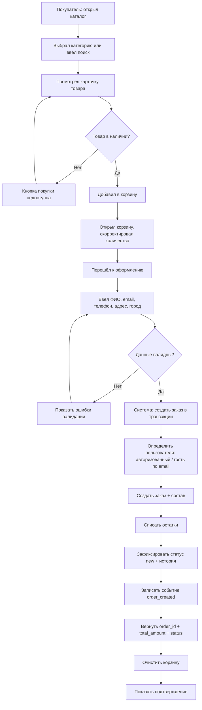
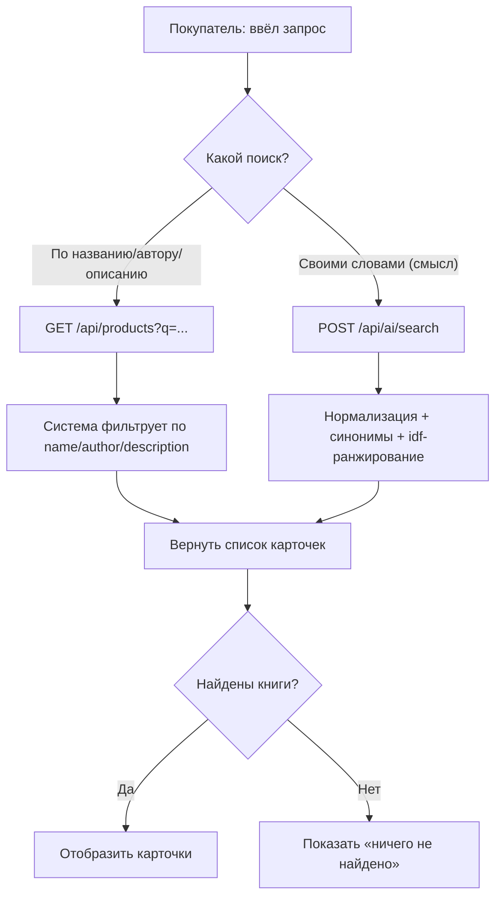
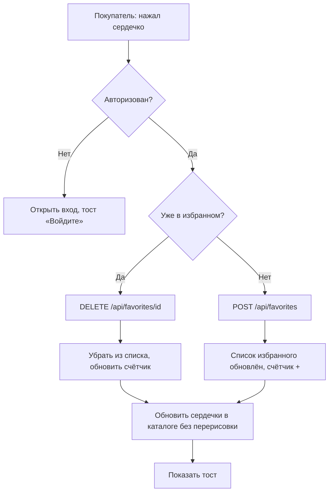
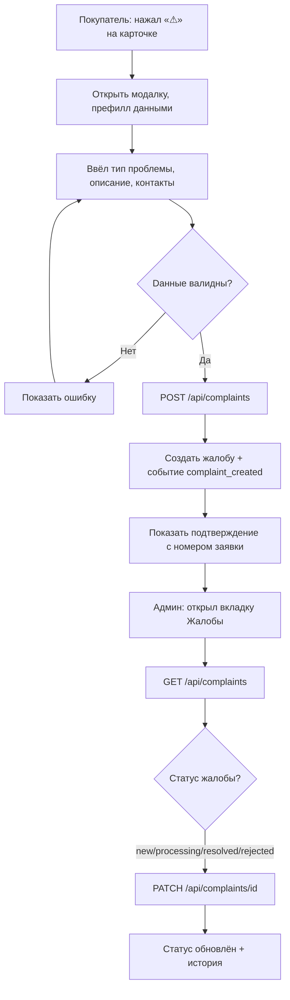
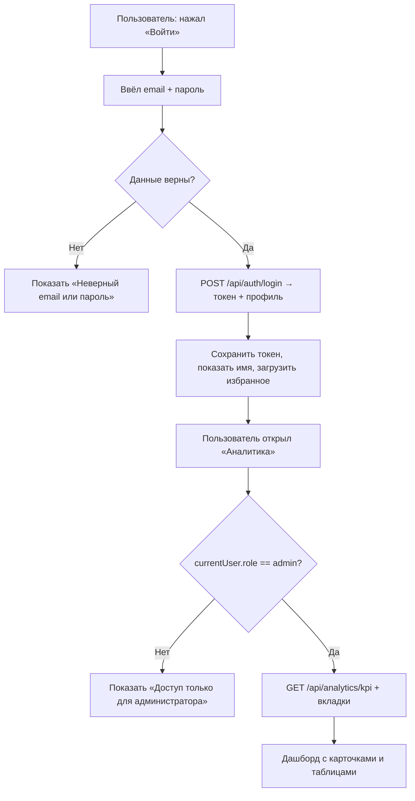
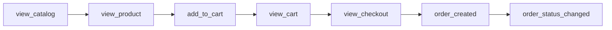
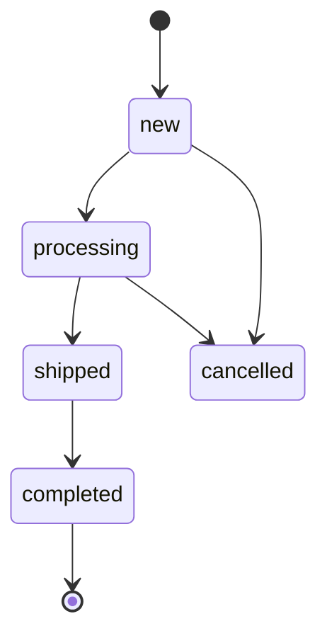

# BPMN — бизнес-процессы bookshop_py

Диаграммы BPMN (используемый синтаксис Mermaid) для ключевых сквозных процессов. Это **логическое** описание порядка шагов; фактические действия и API-вызовы — в [`use-cases.md`](use-cases.md) и [`api.md`](../api.md).

> Диаграммы можно открыть в любом рендерере Mermaid (Mermaid Live, VS Code, GitHub). Пулы описывают «Лейн» покупателя/владельца/системы.

---

## P-01: Оформление заказа

Сквозной процесс «Покупатель выбирает книгу → оформляет заказ → заказ зарегистрирован».

**Участники:** Покупатель (шаги A–K, S–T), Система (L–R).

---

## P-02: Поиск книги (классический + ИИ)

**Участники:** Покупатель, Система.

---

## P-03: Избранное (добавить/убрать)

**Участники:** Покупатель, Система.

---

## P-04: Жалоба о проблеме с книгой

**Участники:** Покупатель (A–H), Администратор (I–M), Система (F–G, L–M).

---

## P-05: Вход и доступ к аналитике

**Участники:** Пользователь, Система.

---

## P-06: Аналитика — воронка покупателя (события)

Показывает, как события пользователя складываются в продуктовую воронку. В `bookshop_py` события пишутся при ключевых шагах и доступны на вкладке «События» (`/api/analytics/event-log`).

> Полный список событий наполняется в PHP-версии (`bookshop_full`); Python-проект читает их через защищённые эндпоинты для аналитики.

---

## P-07: Жизненный цикл заказа (статусы)

Допустимые статусы: `new`, `processing`, `shipped`, `completed`, `cancelled`. Каждая смена фиксируется в `order_status_history` (событие `order_status_changed`).

---

## Сводка: какие процессы отражены

| Код | Процесс | Основной API |
|-----|---------|--------------|
| P-01 | Оформление заказа | `POST /api/orders` |
| P-02 | Поиск (обычный + ИИ) | `GET /api/products?q=`, `POST /api/ai/search` |
| P-03 | Избранное | `/api/favorites*` |
| P-04 | Жалоба | `POST /api/complaints`, `GET/PATCH /api/complaints*` |
| P-05 | Вход и доступ к аналитике | `/api/auth/login`, `/api/analytics/*` |
| P-06 | Аналитика-воронка | `/api/analytics/event-log` |
| P-07 | Жизненный цикл заказа | `PATCH`-статусы (в PHP-админке) / `order_status_history` |